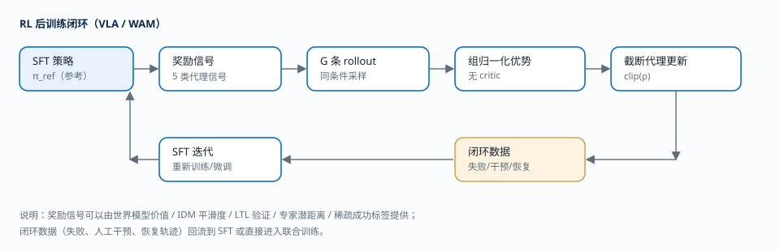
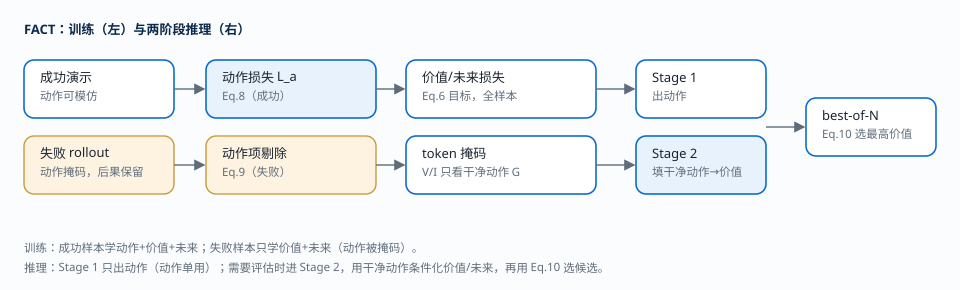

> 阅读约定：每段代码前有 **输入/输出（物理意义）** 与 **变量表**；代码内用 `① ② ③` 标步骤，每步带「物理：…」注释；用到公式时给出公式 + 公式的物理意义。`[论文 §X]`=小节，`[代码 path]`=官方仓库文件；无源码的标「依论文重建」。

---

## 0. TL;DR

- VLA/WAM 的 SFT 有四个硬伤：**分布漂移**、**长程复合误差**、**执行性 gap**、**指令接地差**。RL 后训练针对它们，而不是「再多采点数据」。
- 奖励几乎不直接来自真机执行，而是五种代理：**世界模型价值 / IDM 动作平滑 / LTL 逻辑验证 / 专家潜距离 / 稀疏 episode 成功**。
- 算法两大族：**GRPO**（组归一化优势，无 critic）与 **KL-RL 闭式解 → 加权 NLL**（advantage-conditioned）。
- 闭环训练六类，其中三类有官方代码：FACT、DreamAvoid、τ0-WM。

---

## 1. 为什么后训练

| 失败模式 | 现象 | 介入点 |
|---|---|---|
| 分布漂移 | 偏离演示后误差累积 | 用策略自己的状态采数据（DAgger/HILR） |
| 长程复合 | 单步像、多步崩 | 段级/子任务级奖励，或世界模型长程评分 |
| 执行性 gap | 未来像、动作抖/越限 | IDM 解码后按运动学约束给奖励（EVA） |
| 指令接地差 | 靠画面捷径 | 语言教练/视觉目标重标注（CoachSI） |

---

## 2. 五个 RL 后训练方法

### 2.1 GigaBrain RAMP：KL-RL 闭式解 → 加权 NLL

> 精读（流程图 / 公式 / 代码 / 物理意义）：[方法精读 Wiki · GigaBrain RAMP](/blog/method-wiki/giga-brain.html)

**输入 / 输出（物理）**：输入=真机 episode（观测、本体、动作、指令、成功标签）+ 预训练 VLA + Wan2.2 世界模型；输出=会「看价值信号做动作」的策略，以及同步续训的世界模型。

**代码解读**

| 项 | 内容 |
|---|---|
| 物理意义 | 世界模型学「动作作用后世界怎么变」；价值头学「还剩多少步能成功」；策略学「在 I=1（这步更好）的条件下更像专家」。 |
| 为什么 | 真机奖励极稀疏，策略梯度方差大；KL-RL 闭式解可改写成两项 NLL，变成「带优势条件的模仿」，稳定且无需 critic。 |
| 出处 | 论文 §3.2.1–3.2.2（Eq.2/3/5/6/7/8）；**无官方代码，依论文重建**；谱系：RLHF/DPO → RECAP（特例）。 |
| 优势与代价 | 优势：离线日志可用、无 critic；代价：依赖价值精度，β/γ/n/ε/α 未给。 |

**变量表**

| 变量 | 形状 | 物理意义 |
|---|---|---|
| `o_t` | `[3,H,W]` | t 时刻主视角 RGB |
| `p_t` | `[d]` | 本体（关节角/夹爪） |
| `a_t` | `[H_a,d_a]` | 动作块（H_a 步，d_a 维） |
| `l` | token ids | 语言指令 |
| `success` | bool | episode 是否成功（遥操作日志） |
| `z_t` | `[H′,W′,C′]` | 当前帧 VAE 时空潜 |
| `z_future` | `[H′,W′,C′]` | 未来帧潜（`t+12/24/36/48`，仅训练） |
| `v_t` | 标量 | 价值≈负期望剩余步数 |
| `Ψ(·)` | 广播投影 | 把标量/低维向量复制到空间维（spatial tiling） |
| `s_t` | `[H′,W′,C′+1+d]` | 增强状态 `[z_t;Ψ(v_t);Ψ(p_t)]`（Eq.6） |
| `r_t` | 标量 | 稀疏奖励（Eq.5） |
| `A_t` | 标量 | n 步 TD 优势（Eq.8） |
| `I_t` | {0,1} | `1[A_t>ε]` 改进指示 |

**公式与物理意义**

- Eq.(5) `r_t = 0(成功终步) / −C_fail(失败终步) / −1(其余)`：**成功不罚、失败重罚、每多一步扣一分**——价值函数因此等价于「负的期望剩余步数」。
- Eq.(6) `s_t=[z_t;Ψ(v_t);Ψ(p_t)]`：**把「价值」和「本体」画成图**，与视觉潜拼在一起，让世界模型一次前向同时看到画面、进度与关节。
- Eq.(7) `L_WM=E‖W(s_future^τ,ε)−(s_future−ε)‖²`：流匹配学「从噪声到未来潜的速度场」。
- Eq.(8) `A_t=Σ_{k<n}γ^k r_{t+k}+γ^n v_{t+n}−v_t`：**这一步实得回报 + 未来价值 − 当前价值基线**；>0 表示比预期好。
- Eq.(3) `L=−logπ(a|o,z,l)−αlogπ(a|I,o,z,l)`：**正常模仿 + 在「更好」条件下的模仿**。

**代码（逐步物理注释）**

```python
# ── 输入：episode 字典；输出：一条 episode 的字段 ─────────────────
def sample_episode(D):
    """o [T,3,H,W]；p [T,d]；a [T,H_a,d_a]；l；success: bool。"""
    return {"o": o, "p": p, "a": a, "l": l, "success": success}   # ① 采样一条 episode

# ── 编码：图像 → 潜；② 把像素压成时空潜，下游只在潜空间算 ──────────
def encode(vae, img):                       # img [3,H,W] → [H′,W′,C′]
    return vae.encode(img).latent_dist.mode()             # 取分布众数，确定性

# ── 构造增强状态 s_t（Eq.6）────────────────────────────────────
def build_state(z_t, v_t, p_t, psi_v, psi_p):
    """z_t：画面；Ψ(v_t)：进度图；Ψ(p_t)：本体图。
    ③ 三者通道拼接，世界模型一次前向同时看到『看到什么、走到哪、关节在哪』。"""
    v_map = psi_v(v_t).view(1, h, w)     # 标量 → 单通道（spatial tiling）
    p_map = psi_p(p_t).view(d, h, w)     # 低维向量 → d 通道
    return cat([z_t, v_map, p_map], dim=0)               # [C′+1+d,H′,W′]

# ── 世界模型一步（Eq.7）────────────────────────────────────────
def world_model_step(W, vae, ep, tau):
    """④ 取当前帧与未来帧的潜；⑤ 加噪插值；⑥ 预测速度并回归到 z_future−ε。"""
    z_t = encode(vae, ep["o"][t])                        # 当前帧潜
    s_t = build_state(z_t, W.value(z_t), ep["p"][t], W.psi_v, W.psi_p)
    z_fut = encode(vae, ep["o"][t+i])                    # 未来帧潜（目标）
    eps = randn_like(z_fut)                              # 噪声 ε
    u = (1 - tau) * eps + tau * z_fut                    # 插值潜 u_τ
    return mse(W.flow(u, tau, s_t, ep["a"][t]), z_fut - eps)   # Eq.7

# ── 稀疏奖励（Eq.5）───────────────────────────────────────────
def sparse_reward(ep, C_fail):
    """⑦ 成功=0；失败=−C_fail；其余=−1（时间成本）。"""
    T = len(ep["a"]); r = [-1.0] * T
    r[T-1] = 0.0 if ep["success"] else -C_fail
    return r

# ── 优势（Eq.8）与二值化 ────────────────────────────────────────
def n_step_advantage(r, v, gamma, n):
    """⑧ 用 r 与价值 v 算优势：实得回报 + 未来价值 − 当前价值。"""
    T = len(r); A = [0.0] * T
    for t in range(T):
        k = min(n, T-1-t)
        A[t] = sum(gamma**i * r[t+i] for i in range(k)) \
               + gamma**k * v[min(t+k, T-1)] - v[t]
    return A

# ── 策略损失（Eq.3）───────────────────────────────────────────
def policy_loss(pi, ep, s_t, A, eps_thr, alpha):
    """⑨ 第一项无条件模仿；第二项在 I=1（更好）条件下模仿。
    I 是优势的二值化，作为额外条件 token。"""
    I = [1.0 if a > eps_thr else 0.0 for a in A]         # I_t
    loss = 0.0
    for t in range(len(A)):
        loss += -logp(pi, ep["a"][t], cond=(ep["o"][t], s_t[t], ep["l"])) \
                - alpha * logp(pi, ep["a"][t], cond=(ep["o"][t], s_t[t], ep["l"], I[t]))
    return loss
```

**HILR（Human-in-the-Loop Rollout）**：不是公式，是数据采集——策略跑、人接管、记录 `(obs, a, 是否干预)`、剔除切换边界伪影，然后用它做 Stage 4 联合续训（防优势坍缩）。

### 2.2 VAMPO：GRPO 训练视频去噪器（**官方代码**）

> 精读（流程图 / 公式 / 代码 / 物理意义）：[方法精读 Wiki · VAMPO](/blog/method-wiki/vampo.html)

**输入 / 输出（物理）**：输入=专家视频（SVD VAE 潜 `[B,F,C,H,W]`）+ SFT 后的视频预测器 VPM；输出=后训练 VPM（动作侧冻结）。

**变量表**

| 变量 | 形状 | 物理意义 |
|---|---|---|
| `z0` | `[B,F,C,H,W]` | 初始噪声（F 帧未来） |
| `traj` | `[G,B,F,C,H,W]` | G 条「想象出的未来」 |
| `logp` | `[B,C]` | 首步 SDE 的对数概率（策略梯度用） |
| `r` | `[B,G,F]` | 逐帧奖励：−L1+cosine |
| `adv` | `[B,G,F]` | 组归一化优势 |

**公式与物理意义**

- 采样（ancestral）：`x_{k+1}=x_k+derivative·dt+noise·σ_up`——**确定漂移 + 随机注入**；σ 大时多注入（探索），σ 小时收敛。
- 奖励：`r=−L1(pred,expert)+cos(pred,expert)`——**结构像 + 方向像**。
- GRPO：`A=(r−mean_G)/std_G`——**同组比较**；`loss=min(ρA, clip(ρ)A)`——**悲观截断**。

**代码（逐步物理注释）**

```python
# ── ① 采样：G 条未来；只有首步 SDE 有随机性与 log-prob ─────────────
def rollout_group(vpm, z0, cond, G=8, steps=20):
    trajs, logps = [], []
    for g in range(G):
        z, logp = z0.clone(), 0.0
        for i, t in enumerate(scheduler.timesteps(steps)):
            if i == 0:                                   # 首步：真采样噪声（SDE）
                z, logp = eas_step_with_logprob(vpm, z, t, cond)
            else:                                        # 其余：确定性 Euler（ODE）
                z = euler_step(vpm, z, t, cond)
        trajs.append(z); logps.append(logp)
    return trajs, logps

# ── ② 奖励：潜空间一致性（不解码像素）──────────────────────────
def latent_reward(pred_latents, expert_latents):
    """L1 管结构（物体在哪、多大）；cosine 管方向（整体变化趋势）。"""
    mae    = l1(pred_latents, expert_latents).mean(dim=[2,3,4])   # [B,F]
    cosine = cosine_sim(pred_latents.flatten(2), expert_latents.flatten(2))
    return -mae + cosine                              # 逐帧奖励

# ── ③ 更新：组优势 + 截断代理 ──────────────────────────────────
def grpo_update(vpm, trajs, logps, expert_latents, clip=0.2):
    r   = [latent_reward(z, expert_latents) for z in trajs]        # [G,B,F]
    adv = (r - mean(r)) / (std(r) + 1e-8)                          # 组归一化
    loss = 0
    for z, lp, a in zip(trajs, logps, adv):
        ratio = exp(new_logprob(vpm, z) - lp)                      # π_new/π_old
        loss += min(-a*ratio, -a*clip(ratio, 1-clip, 1+clip))      # 悲观截断
    vpm.update(loss)                                  # 只更新 VPM
```

### 2.3 EVA：IDM 动作平滑度奖励 + Flow-GRPO

> 精读（流程图 / 公式 / 代码 / 物理意义）：[方法精读 Wiki · EVA](/blog/method-wiki/eva.html)

**输入 / 输出（物理）**：输入=生成视频 + 冻结 IDM；输出=生成器 LoRA 的梯度。

**变量表**

| 变量 | 形状 | 物理意义 |
|---|---|---|
| `q` | `[T,D]` | IDM 解码的关节序列（T 帧，D 关节） |
| `v,a,j` | `[T−1,D]` 等 | 速度/加速度/jerk |
| `R` | 标量 | 动作质量奖励 |

**公式与物理意义**：`R=−(λj·Huber(j)+λα·Huber(a)+λv·max(|v|−vmax,0)²+λa·max(|a|−amax,0)²)`——**惩罚抖动、急加速、越限**；限幅项专门堵「不动骗奖励」。

**代码（逐步物理注释）**

```python
def eva_reward(video, idm, vmax, amax, lam):
    """① 解码成关节序列；② 差分出速度/加速度/jerk；③ 加权惩罚。"""
    q = idm.decode(video)                     # [T,D]
    v = diff(q); a = diff(v); j = diff(a)     # 运动学量
    return -(lam.j*huber(j) + lam.a*huber(a)
             + lam.v*relu(abs(v)-vmax).pow(2)
             + lam.a2*relu(abs(a)-amax).pow(2))   # 标量奖励

def flow_grpo_step(gen, videos, prompts):
    """④ 组内比较；⑤ KL 防止丢掉预训练画面先验。"""
    rs  = [eva_reward(v, idm) for v in videos]
    adv = (rs - mean(rs)) / (std(rs) + 1e-8)
    gen.update(clipped_surrogate(adv, ratio) - beta * KL(gen, gen_ref))  # 仅 LoRA
```

### 2.4 CreFlow：LTL 稀疏奖励 + DiffusionNFT + corrective reflow

> 精读（流程图 / 公式 / 代码 / 物理意义）：[方法精读 Wiki · CreFlow](/blog/method-wiki/creflow.html)

**输入 / 输出（物理）**：输入=rollout 视频 + 离线 LTLf 规格 + 冻结参考 Vidar；输出=生成器梯度。

**公式逐条与物理意义**

| 公式 | 内容 | 物理意义 |
|---|---|---|
| Eq.(5) | `(r,𝒱,𝒮)=ℳ_c(x0;y)` | 哪一帧违反了哪条时序约束、涉及哪个物体 |
| Eq.(6) | `M = M_T ⊗ M_S` | 只在「出错的帧 × 相关物体」上加梯度；整组成功则 M≡0 |
| Eq.(7) | `L_CA-NFT = E[r‖M⊙(v⁺−v̂)‖²+(1−r)‖M⊙(v⁻−v̂)‖²]` | 好样本拉向数据速度；坏样本**反射**推开；`v⁺=(1−β)v_old+βv_θ`、`v⁻=(1+β)v_old−βv_θ` |
| Eq.(8) | `x̄₀⁺ = mean_{j∈P} x₀^(j)` | 同条件下成功样本的「平均结局」，给失败样本一个具体靠拢点 |
| Eq.(9) | `L_CR = E_{i∈N}‖M⊙(x̂₀^(i)−x̄₀⁺)‖²` | 失败样本单步反推 x0 → 拉向成功均值；只对失败集 |

**代码（逐步物理注释）**

```python
def ltl_monitor(video, spec):
    """① 把视频提升成「实体状态轨迹」，逐子句验证。"""
    return spec.check(frames(video))          # (r, witness, entity_masks)（Eq.5）

def group_mask(witnesses, entity_masks):
    """② 时间掩码 ∪ 实体掩码 → 组共享 mask（Eq.6）。"""
    M_T = union_frames(witnesses)             # [T]
    M_S = union_entities(entity_masks)        # [T,H,W]
    return M_T.view(-1, 1, 1) * M_S

def ca_nft_loss(vpm, x_t, v_hat, r, M, beta):
    """③ 正分支强化好样本；负分支反射坏样本；只在 mask 区梯度。"""
    v_plus  = (1 - beta) * v_old + beta * v_theta
    v_minus = (1 + beta) * v_old - beta * v_theta
    loss_pos = r       * (M.unsqueeze(0) * (v_plus  - v_hat)).pow(2)
    loss_neg = (1 - r) * (M.unsqueeze(0) * (v_minus - v_hat)).pow(2)
    return (loss_pos + loss_neg).mean()

def corrective_reflow(vpm, rollouts, rewards, M, t):
    """④ 成功均值；⑤ 失败样本单步 x0 向均值靠拢（Eq.8/9）。"""
    x0_pos = [r.x0 for r in rollouts if r.reward == 1]
    x_bar_pos = mean(x0_pos)
    loss = 0.0
    for r in rollouts:
        if r.reward != 0: continue
        x0_hat = r.x_t - t * vpm(r.x_t, t, r.cond)
        loss = loss + (M.unsqueeze(0) * (x0_hat - x_bar_pos)).pow(2).mean()
    return loss
```

### 2.5 WorldVLN：自回归 WAM 的段级 GRPO

> 精读（流程图 / 公式 / 代码 / 物理意义）：[方法精读 Wiki · WorldVLN](/blog/method-wiki/worldvln.html)

**输入 / 输出（物理）**：输入=在线模拟器、真实观测流、目标；输出=整段动作的策略梯度。

**变量表 / 公式**

| 变量 | 形状 | 物理意义 |
|---|---|---|
| `seg` | `[H_a,d_a]` | 一个段的动作块 |
| `r_traj` | 标量 | 与专家轨迹相似度 `1/(1+‖a−a*‖)` |
| `r_task` | 标量 | 终点离目标 `1/(1+d)` |
| `r_ref` | 标量 | 参考策略对数概率 `log π_ref` |
| `r_j` | 标量 | `γ^{j−1}(λ_traj r_traj+λ_task r_task+λ_ref r_ref)` |
| `A_j` | 标量 | 组相对优势 `(r_j−mean)/std` |

**代码（逐步物理注释）**

```python
def worldvln_step(model, segs, goal, gamma, lam):
    """① 逐段算三项奖励；② 段间时间衰减；③ 组归一化优势；④ 截断代理。"""
    R = []
    for j, seg in enumerate(segs, start=1):
        r_traj = 1/(1 + dist(seg.a, seg.a_star))     # 像专家
        r_task = 1/(1 + dist(seg.end, goal))         # 到目标
        r_ref  = logp_ref(seg.a, seg.s)              # 别漂
        R.append(gamma**(j-1) * (lam.traj*r_traj + lam.task*r_task + lam.ref*r_ref))
    R = tensor(R)
    A = (R - R.mean()) / (R.std() + 1e-8)            # 组相对优势
    loss = -min(ratio*A, clip(ratio, .8, 1.2)*A).mean()
    model.update(loss)
```

---

## 3. 六类闭环训练

> 总览：闭环 = 让策略执行自己的动作，并把执行后果（失败、干预、恢复、模拟器反馈）纳入训练。



### 3.1 HILR（Human-in-the-Loop Rollout，人机接力）

> 精读（流程图 / 公式 / 代码 / 物理意义）：[方法精读 Wiki · HILR](/blog/method-wiki/hilr.html)

**输入 / 输出（物理）**：输入=当前策略、环境、人类接管判断；输出=一条带「是否人接管」标记的轨迹（已剔除切换抖动）。

| 变量 | 形状 | 物理意义 |
|---|---|---|
| `obs` | `[3,H,W]` | 当前相机画面 |
| `a` | `[d_a]` | 这一步的动作（策略或人给的） |
| `flag` | {0,1} | 1=这一步由人接管 |
| `traj` | `T×{obs,a,flag}` | 整条轨迹 |

```python
def hilr_episode(policy, env, human):
    """① 策略自主跑；② 人判断快失败就接管；③ 记录标记；④ 去切换伪影。"""
    traj, obs, done = [], env.reset(), False
    while not done:
        a = policy.act(obs)                       # 策略动作
        flag = 0
        if human.wants_control(obs):              # 人判断：这一步会失败
            a, flag = human.act(obs), 1           # 人给纠正动作
        traj.append((obs, a, flag))               # 记录「状态-动作-是否干预」
        obs, done = env.step(a)                   # 环境推进
    return scrub(traj)                            # 剔除切换瞬间的动作突变
```

**为什么**：遥操作数据都在专家分布上；HILR 采的是「策略快失败」的边界样本，对策略最有信息量。
**物理**：`flag=1` 的那几步就是「机器人不会、人会」的地方；`scrub` 去掉切换瞬时的速度/位置跳变，否则策略学到不连续动作。

### 3.2 DAgger（Dataset Aggregation）与 XPACE 恢复数据

> 精读（流程图 / 公式 / 代码 / 物理意义）：[方法精读 Wiki · DAgger](/blog/method-wiki/dagger.html) ／ [XPACE 恢复数据](/blog/method-wiki/xpace.html)

**输入 / 输出（物理）**：输入=专家策略、初始演示、迭代轮数；输出=在「学生自己会走到的状态」上也能正确动作的策略。

| 变量 | 形状 | 物理意义 |
|---|---|---|
| `D` | 数据集 | 初始只有专家演示；后追加「学生状态 + 专家动作」 |
| `states` | 状态列表 | 学生策略实际访问到的状态（关键） |
| `labels` | 动作列表 | 专家在这些状态上的动作 |
| `pi` | 策略 | 每轮在聚合数据上重训 |

```python
def dagger(expert, D, N):
    """① 先克隆；② 学生跑、收它自己的状态；③ 问专家要标签；④ 聚合；⑤ 重训。"""
    pi = train_bc(D)                              # ① 行为克隆初始化
    for i in range(N):
        states = rollout_states(pi)               # ② 学生状态分布（不是专家的）
        labels = [expert.act(s) for s in states]  # ③ 专家标签
        D = D + list(zip(states, labels))         # ④ Dataset Aggregation
        pi = train_bc(D)                          # ⑤ 重训
    return pi
```

**公式**：训练目标就是行为克隆的负对数似然 `L=−E_{(s,a*)∼D}[log π(a*|s)]`——**物理**：在聚合后的状态分布上，让策略对专家动作的似然最大。

**XPACE 的工程映射**：注入偏差=学生状态；模拟器推演恢复=专家标签；恢复数据 ~8% 与专家混合；额外加一致性过滤。恢复消融 61.7→86.7（异套件）。

### 3.3 FACT：失败数据闭环（**官方代码**）

> 精读（流程图 / 公式 / 代码 / 物理意义）：[方法精读 Wiki · FACT](/blog/method-wiki/fact.html)

**输入 / 输出（物理）**：输入=成功演示 + 失败 rollout（带结果与失败起点）；输出=同时会出动作、预测未来、估进度的因果 WAM。



| 变量 | 形状 | 物理意义 |
|---|---|---|
| `o, l` | 图像 / token | 当前观测与指令 |
| `a_gt` | `[H,d_a]` | 演示里的真实动作块（teacher forcing 用） |
| `a_pred` | `[H,d_a]` | 模型预测的动作块 |
| `value_target` | 标量 ∈[0,1] | 进度目标（Eq.6：成功 p_{t+H}，失败下调） |
| `mask` | {0,1} | 1=成功可模仿，0=失败 |
| `L_a, L_v, L_I` | 标量 | 动作/价值/未来三路损失 |

**公式与物理意义**

| 公式 | 内容 | 物理意义 |
|---|---|---|
| Eq.(2) | `p(o',v\|o,l,a)` | 给动作，预测它会带来的画面与进度 |
| Eq.(3) | `p_t=G_t/G_T`（均匀奖励 `t/T`） | 把「离完成还有多远」归一化到 0–1 |
| Eq.(4) | 世界分支用干净 `a_gt` | 后果预测不被「还没学会的动作」污染 |
| Eq.(6) | 成功 `p_{t+H}`；失败 `clip(p−λ_fail,0,1)` | 失败动作的进度应更低（λ_fail=1） |
| Eq.(8) | `L_s=w_aL_a+w_vL_v+w_IL_I` | 成功：行为与后果都学 |
| Eq.(9) | `L_f=w_vL_v+w_IL_I` | 失败：只学后果（动作项被剔除） |
| Eq.(10) | `a*=argmax V(o,l,a^(k))` | 推理时用价值给候选打分 |

```python
action_loss_mask = batch['action_loss_mask']        # 1=成功, 0=失败

def _masked_mean(loss, mask):
    """① 失败样本动作项置零——失败教『后果』，不教『动作』（Eq.9）。"""
    m = mask.reshape(-1)
    return (loss * m).sum() / m.sum().clamp_min(1e-8)

def fact_train_step(batch, model):
    """② 三路损失：动作（掩码）、价值（全样本）、未来（全样本）。"""
    pred_action, pred_value, pred_future = model(batch)          # 共享 DiT，动作 adapter
    L_act = _masked_mean(action_loss(pred_action, batch.a), action_loss_mask)
    L_val = mse(pred_value, batch.value_target)                  # Eq.6 目标
    L_fut = flow_mse(pred_future, batch.future_latents)
    return 20.0*L_act + 1.0*L_val + 1.0*L_fut                    # w_a=20, w_v=w_I=1

def fact_infer(obs, instruction, N=1):
    """③ Stage 1 出动作；④ 需要时 Stage 2 用干净动作条件化价值；⑤ 选最高价值。"""
    a = denoise_action(obs, instruction, steps=20)               # Stage 1
    if N == 1: return a                                          # 动作单用
    cands = [denoise_action(obs, instruction) for _ in range(N)]
    scores = [value_head(obs, instruction, c) for c in cands]    # Stage 2
    return cands[argmax(scores)]                                 # Eq.10
```

**实现细节**：Wan2.2-5B 初始化；动作 FFN `2e-4`、骨干 `2e-5`；`H=48`；未来帧偏移 `[0,H/4,H/2,3H/4,H]`；20 步 flow-Euler。

### 3.4 DreamAvoid：混合数据价值模型 + 触发式 dreaming（**官方代码**）

> 精读（流程图 / 公式 / 代码 / 物理意义）：[方法精读 Wiki · DreamAvoid](/blog/method-wiki/dreamavoid.html)

**输入 / 输出（物理）**：输入=当前画面、候选动作块、该动作预测出的未来帧、任务、状态；输出=标量价值（越高越不会失败）。

| 变量 | 形状 | 物理意义 |
|---|---|---|
| `obs` | `[3,H,W]` | 当前画面 |
| `future` | `[L,3,H,W]` | 候选动作导致的未来帧 |
| `action` | `[H_a,d_a]` | 候选动作块 |
| `state` | `[d]` | 本体 |
| `V` | 标量 | 价值（安全/进度） |

```python
class ValueModel(nn.Module):
    """① DINOv2 逐帧编码；② value token 汇总时序；③ 与动作/任务/状态拼接出价值。"""
    def forward(self, obs, future, action, state, task_id):
        obs_tok = encoder(obs) + frame_emb[0]                  # 当前帧 token
        fut_tok = encoder(future) + frame_emb[1] + time_emb[:L]  # 未来帧 token
        seq = transformer([value_token] + obs_tok + fut_tok)   # 时序注意力
        x = cat([seq[:, 0], proj(action), task_emb(task_id), proj(state)])
        return head(x).squeeze(-1)                             # 标量价值

def dream_avoid_step(policy, value_model, obs, state, task):
    """④ 未到关键阶段直接执行；⑤ 关键阶段才采候选、梦未来、选最高价值。"""
    if not trigger(obs): return policy.act(obs)                # 省算力
    cands = [policy.sample_action(obs) for _ in range(8)]      # 8 个候选
    return max(cands, key=lambda a: value_model.score(
        obs, rollout_future(policy, obs, a), a, state, task))
```

**公式**：`V=f(obs,future,a,state,task)`——**物理**：价值不是「动作本身好不好」，而是「这个动作导致的未来看起来会不会失败」。

### 3.5 τ0-WM：propose → RCS 排序 → 模拟器精炼（**官方代码**）

> 精读（流程图 / 公式 / 代码 / 物理意义）：[方法精读 Wiki · τ0-WM](/blog/method-wiki/tau0-wm.html)

**输入 / 输出（物理）**：输入=观测、状态、候选数 N；输出=选中动作块（可截短执行步数）。

| 变量 | 形状 | 物理意义 |
|---|---|---|
| `cands` | `[N,H_a,d_a]` | N 个候选动作块 |
| `rcs` | `[N]` | 重去噪一致性分数（可信度） |
| `sim_rewards` | `[N,T]` | 模拟器给出的逐步回报 |
| `step` | int | 实际执行几步（取回报峰值前） |

```python
def play(obs, state, N_proposals=8):
    """① 生成 N 候选；② RCS 选最可信；③ 模拟器回报决定执行步数。"""
    pred = pipeline.infer(obs, state, N_proposals=N_proposals, get_RCS=True)
    cands, rcs = pred['action'], pred['rcs']           # 候选 + 可信度
    best = cands[rcs.max(dim=0).indices]               # RCS 最高者
    if sim_refine:
        sim_rewards = sim_pipeline.infer(actions=cands, return_reward=True)
        if sim_rewards.max() < 0:
            best = re_predict_with_sim_latent(...)     # 全差 → 用模拟器潜重生成
        else:
            best = cands[best_idx, :argmax(sim_rewards)+1]  # 只执行峰值前
    return best
```

**公式**：`RCS = −E_{K 个随机时间步}[‖ε−ε̂(z_t,t)‖²]`（重去噪误差的负值）——**物理**：一条候选如果「重新加噪再加噪不回去」，说明它是偶然采样，不可信。

### 3.6 CoachSI：语言教练 relabel

> 精读（流程图 / 公式 / 代码 / 物理意义）：[方法精读 Wiki · CoachSI](/blog/method-wiki/coachsi.html)

**输入 / 输出（物理）**：输入=冻结 VLM、成功轨迹、原任务指令；输出=带「下一步该做什么」标签的轨迹。

| 变量 | 形状 | 物理意义 |
|---|---|---|
| `seg` | 帧窗口 | 轨迹切出的一段 |
| `steps` | 文本 | VLM 命名的「下一步」 |
| `traj'` | `T×{obs,a,step}` | 新监督：动作 + 语义意图 |

```python
def coach_relabel(traj, vlm, task):
    """① 切段；② VLM 命名下一步；③ 用命名做新监督（动作骨干冻结）。"""
    steps = [vlm.describe(seg.frames, task, "next step?") for seg in segment(traj)]
    return [(seg.obs, seg.action, s) for seg, s in zip(segment(traj), steps)]
```

**物理**：机器人失败常是「不知道该干哪一步」；VLM 把成功轨迹命名成子任务，等于补上语义监督，且不改动作模型。

---

## 4. 六类闭环对照

| 类 | 数据从哪来 | 信号 | 更新什么 | 代码 |
|---|---|---|---|---|
| HILR | 人接管边界 | 无（模仿） | 策略 | 无公开 |
| DAgger | 学生访问状态 + 专家标签 | 专家动作 | 策略 | 无公开 |
| 失败数据（FACT） | 真机失败 rollouts | 掩码 + 价值 | 策略+价值 | [Bariona/FACT](https://github.com/Bariona/FACT) |
| 混合价值（DreamAvoid） | 成功/失败/边界 | 学出的价值 | 价值+推理选优 | [XianzheFan/DreamAvoid](https://github.com/XianzheFan/DreamAvoid) |
| 模拟器精炼（τ0-WM） | 候选 + 模拟器 | RCS + 模拟回报 | 不更新（推理选优） | [sii-research/tau-0-wm](https://github.com/sii-research/tau-0-wm) |
| 语言教练（CoachSI） | 成功轨迹 | VLM 命名 | 指令跟随 | 项目页 |

---

## 5. 工程清单

1. 奖励能否离线算？能 → 离线 GRPO；不能 → 在线 rollout。
2. 有无失败数据？有 → FACT 式掩码；无 → 先补采。
3. 防退化三件套：KL/参考锚定、优势裁剪、混合 SFT 损失。
4. 评测：成功率 + 完成时间 + 进度；报告相对 SFT 的增量。
5. 算力：在线 RL ≈ 单次推理 × G（G=8、20 步 ≈ 160×）。

---

## 6. 坑

- 伪代码必须能落地：函数签名、输入输出、数据流、变量物理意义，缺一不可。
- 公式要映射代码行；论文没给的超参写「未给」。
- 自评数字：跨论文比较先看协议。
- 奖励 hacking：平滑度可被「不动」骗过（EVA 用限幅堵）。
- 闭环≠更好：世界模型偏差会被放大。

---

## 7. 术语附录

### 7.1 `q` 的 shape（EVA）

`q ∈ R^{T×D}`：`T` 动作帧、`D` 关节维（双臂 14、单臂 7）；`v/a/j` 逐阶差分。`T/D` 论文未给。

### 7.2 LoRA（Low-Rank Adaptation）

冻结 `W0 ∈ R^{d×k}`，学 `ΔW=BA`（`B∈R^{d×r}`、`A∈R^{r×k}`）：`h=W0x+(α/r)BAx`；`A~小方差`、`B=0` 初始化；推理可合并 `W'=W0+(α/r)BA`。

```python
class LoRALinear(nn.Module):
    """物理：给冻结层加低秩旁路，只学任务增量。"""
    def __init__(self, base, r=16, alpha=16):
        self.base, self.scale = base, alpha/r
        self.A = nn.Parameter(torch.randn(r, base.in_features) * 0.01)
        self.B = nn.Parameter(torch.zeros(base.out_features, r))
        for p in base.parameters(): p.requires_grad_(False)
    def forward(self, x):
        return self.base(x) + self.scale * (x @ self.A.T @ self.B.T)
```

### 7.3 GRPO（Group Relative Policy Optimization）

组内标准化优势 + 截断代理，无 critic：
`Â=(r−mean_G)/std_G`；`J=E[min(ρÂ, clip(ρ,1−c,1+c)Â)] − βD_KL`。

```python
adv = (r - r.mean()) / (r.std() + 1e-8)      # 组内基线
ratio = torch.exp(logp - logp_old)
loss = -torch.min(ratio*adv, torch.clamp(ratio, 1-c, 1+c)*adv).mean()
```

---

## 8. 参考

- GigaBrain-0.5M*（RAMP）：arXiv 2602.12099（无官方代码）
- VAMPO：arXiv 2603.19370 · [OpenHelix-Team/VAMPO](https://github.com/OpenHelix-Team/VAMPO)
- EVA：arXiv 2603.17808
- CreFlow：arXiv 2605.14274
- WorldVLN：arXiv 2605.15964
- FACT：arXiv 2608.10232 · [Bariona/FACT](https://github.com/Bariona/FACT)
- DreamAvoid：arXiv 2605.11750 · [XianzheFan/DreamAvoid](https://github.com/XianzheFan/DreamAvoid)
- τ0-WM：arXiv 2606.01027 · [sii-research/tau-0-wm](https://github.com/sii-research/tau-0-wm)
- CoachSI：arXiv 2611.25529
- DreamGen（开环反例）：arXiv 2505.12705
- WAM 论文站：/blog/wam-survey/
