# 数据飞轮

> 图例：🟢 有成功案例　🟡 对比 / 一阶段　🔴 尚无人做到

---

## 一页速览

1. 数据飞轮由三个大闭环组成：测试闭环、数据闭环、训练闭环。运营是核心，问题从运营来、回运营验证。
2. 每个闭环内部再分感知与 e2e（one-stage VA）两条线。
3. WM 不进结构图，是每个闭环的预研方案：测试侧代替测试、数据侧代替采集、训练侧嵌入训练。
4. 健康度看单个运营问题的解决周期 N 与成本：N 由采集 ~30 天降到挖掘 ~7 天。
5. 运营指标：MPCI、MPI、平均速度。

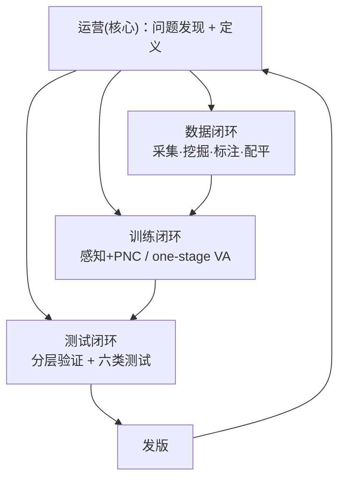

---

## 0. 总览：数据飞轮 = 三大闭环

### 0.1 三大闭环对比

| 维度 | 测试闭环 | 数据闭环 | 训练闭环 |
|---|---|---|---|
| 目标 | 验证、发版把关、问题转 test case | 产出对的数据 | 产出对的模型 |
| 输入 | 模型 + 运营场景 | 运营问题分布 | 配平后的数据 |
| 输出 | 发版门禁 + 问题回流 | 训练集 / 场景集 | 模型 |
| 感知线 | MIL 开环 + SIL | 场景采集·tag 配平 | 感知 + PNC |
| e2e 线 | SIL 闭环 | 行为采集·轨迹+速度配平 | one-stage VA（pretrain→ft→post） |
| 预研方案（WM） | 代替测试：neural sim + 数据孪生二阶段 | 代替采集：生成训练/场景集 | 嵌入训练：共享主干 |

> WM 整体预研；三处预研方案由同一个 WM（双路径生成）提供。

### 0.2 飞轮健康度：D+N 与 TCO（整体评估）

1. 运营问题在第 D 天暴露、第 D+N 天解决，N 为解决周期。判据：N 缩短、成本下降。
2. 指标分层：原子（TP/FP/FN）→ 功能（MPI/MPCI/百公里误刹）→ 运营（MPCI/MPI/平均速度）。


| 阶段 | 解决方式 | N | 特征 |
|---|---|---|---|
| 初期 | 采集+训练 | ~30 天 | 依赖新采集 |
| 中期 | 采集+训练 | ~10 天 | 流程提效 |
| 后期 | 挖掘+训练 | ~7 天 | 免新采集 |
| 展望 | WM 生成+训练 | ↓ 更短 | 生成代替采集/挖掘 |

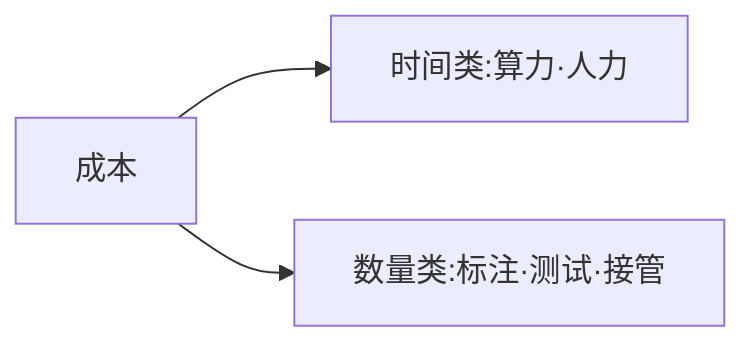

各闭环的价值与 TCO 汇总到最终 D+N（发版解决问题）：


| 闭环 | 贡献的 N 段 | TCO（时间类 / 数量类） | 价值 |
|---|---|---|---|
| 数据闭环 | 采集→挖掘→标注→配平 | 算力·人力 / 采集量·标注量 | 供给对的数据 |
| 训练闭环 | 训练（感知 / e2e） | 算力·训练 / 训练任务数 | 产出对的模型 |
| 测试闭环 | 定义问题→验证→发版 | 仿真·人力 / test case·测试次数 | 把关 + 定义问题 |
| **合计** | **= N** | **= 总 TCO** | **D+N 发版解决问题** |

---

## 1. 测试闭环

> 参考文档：[AD - 测试体系](https://r3c0qt6yjw.feishu.cn/docx/DrBrd4lSJo0x28xjKMtc8d8Enxc)
> 价值：验证把关 + 定义问题（转 test case）｜TCO：仿真·人力（时间）+ test case·测试次数（数量）

### 1.1 分层验证体系

| 层级 | 验证对象 | 备注 |
|---|---|---|
| MIL | 模型（主感知；e2e 阶段=中间结果 debug / pretrain MIL） | 开环单任务 |
| SIL | e2e + pnc | 全链路闭环准出 |
| HIL | 系统稳定性 + 硬件 | 已在用·主要压测 |
| 实车 | 限定场景综合 | 与 SIL 同级 |
| 数据孪生 | 整城完整路线 | 云端·见 1.4 |
| 运营 | 长时间综合 | 飞轮核心·发现+定义问题 |


### 1.2 六类测试方法

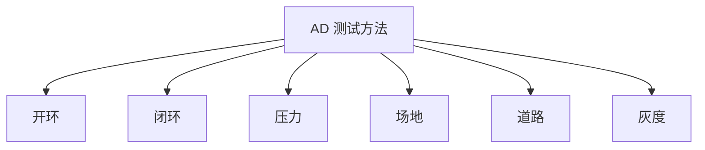

### 1.3 各层测试需求（由运营数据驱动）

| 层级 | 由运营数据驱动的需求 |
|---|---|
| MIL | 1. 提取感知导致的接管场景/问题；2. 接管数据 → model evaluation test case |
| SIL | 1. 按运营数据重新归类场景；2. 设 SIL 发版门槛；3. 丰富 SIL checker |
| HIL | 无额外需求·仅硬件压测 |
| on-road | 场景按运营数据调整专项测试 |

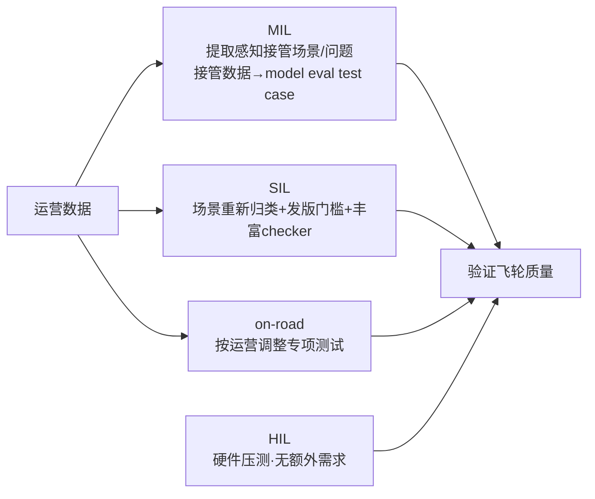

### 1.4 数据孪生（云端·holdout 城市）

1. 选一个城市，其数据不进训练集；把整城完整路线作为物理世界的数字孪生测试集。
2. 一阶段：不用 WM，仅用采集数据，收敛感知与地图问题。
3. 二阶段：引入 WM，收敛交互问题。

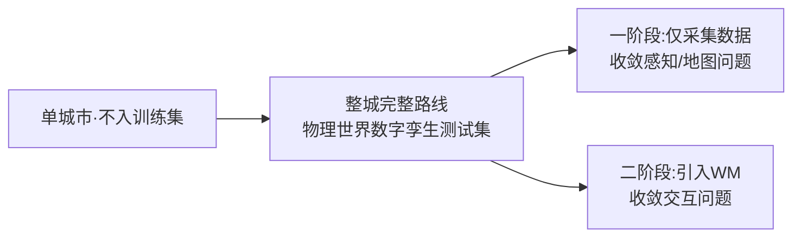

### 1.5 问题状态：两套视角

1. 测试体系内：问题可关闭，走状态机（主状态机 6 态 + 聚类桶 9 态）。
2. 运营体系内：问题难以完全关闭，跟踪天梯排序下移（top 问题占比下降）。
3. 机制：桶键 = 问题现象码 × 研发域；自动派单 + 四级回退升级；系统驱动、禁手动跨级、全程可审计。

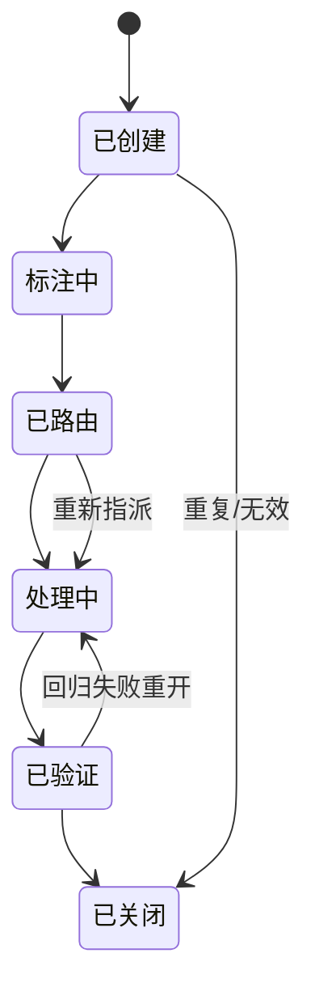

### 1.6 车云不一致（数据分布问题）

1. 原因：测试集与运营的数据分布不同——测试集偏 hard case，运营是真实运行分布。
2. 处理：不追求分布对齐，用运营价值排优先级。

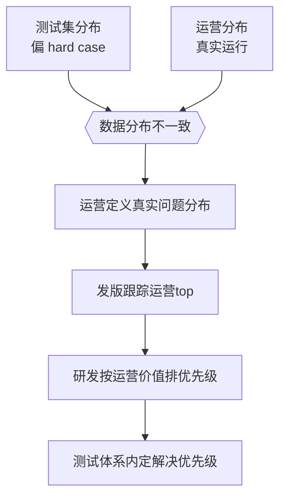

### 1.7 评估口径

原子指标只用 TP/FP/FN，向上聚合到功能与运营指标：

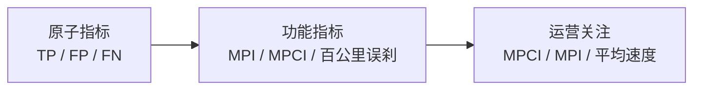

| | 感知(+PNC) | one-stage e2e |
|---|---|---|
| 主评估 | 开环·各类单任务 | 闭环为主 |
| 对应 | MPI/MPCI 背后感知问题 | 行为正确 + 闭环安全 |
| 例外 | — | 🟢Tesla 可 MIL 中间 debug；🟡小鹏一阶段无 |
| 门禁 | MIL 开环 | SIL 闭环（MIL+SIL 双门禁） |

版本闭环预测用预实比：

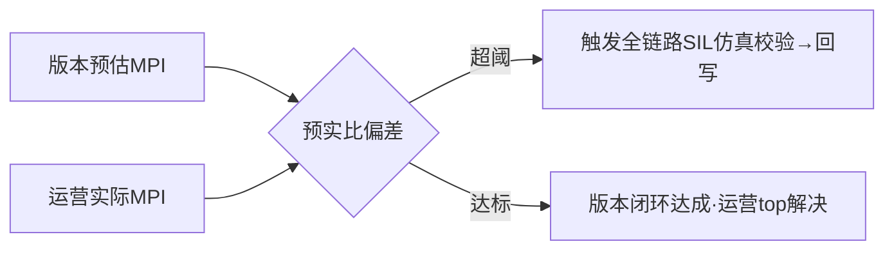

### 1.8 问题 → 采集：现状人工，目标 pipeline

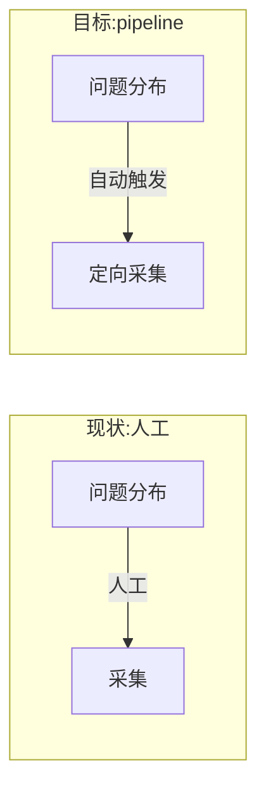

### 1.9 预研方案：WM 代替测试

流程变化：

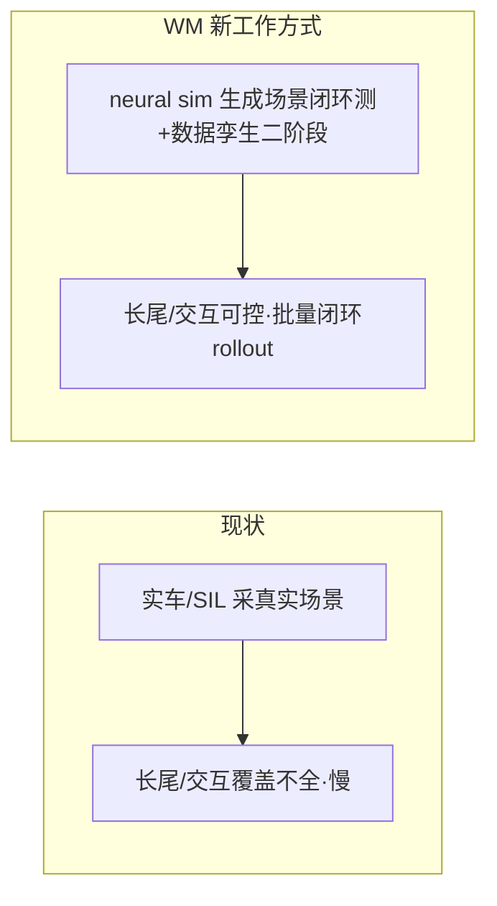

| | 优势 | 劣势 |
|---|---|---|
| 现状（实车 / SIL） | 真实、可信 | 长尾/交互覆盖不全、慢、贵 |
| WM 代替测试 | 长尾可控、批量闭环 rollout、成本低 | 保真度待验证；闭环 rollout 极难（🟢仅 Wayve/Tesla·🔴国内空白） |

---

## 2. 数据闭环

> 参考文档：[数据闭环](https://r3c0qt6yjw.feishu.cn/wiki/XS3twCuPAiutVbku6E4cERQ3n9e)
> 价值：供给对的数据｜TCO：算力·人力（时间）+ 采集量·标注量（数量）

### 2.1 数据来源

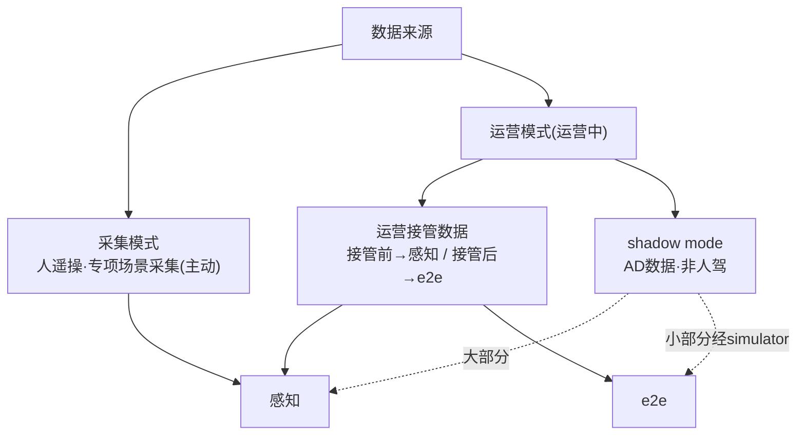

1. 采集模式：人遥操开，做专项场景采集（主动）。
2. 运营模式（运营中）：运营接管数据（接管前→感知 hard case，接管后→e2e）+ shadow mode（AD 数据、非人驾）。
3. shadow → 人驾(SD) 链路未打通：shadow 主体供感知，小部分经 simulator 转 e2e。

### 2.2 数据全链路


### 2.3 两类采集与 GT

| | 感知 | e2e |
|---|---|---|
| 主采集 | 专项采集为主·影子为辅（逐步迁移） | 接管后轨迹；shadow 行为（经 simulator） |
| GT | 感知真值（预刷 / 自动真值） | 人驾车 / SD 遥操车 |
| 离线优化 | — | MoE 规则专家 |
| clip | 可短 | 长 |

e2e GT 的 SD 链路分两期，当前整条未打通：

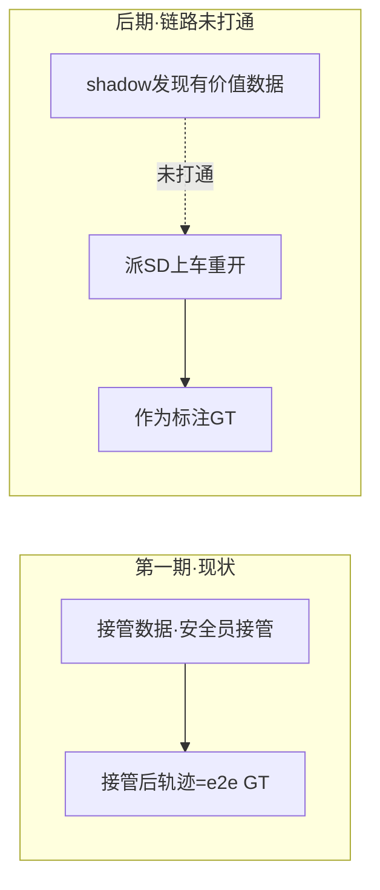

### 2.4 配平（测试 + 运营 牵引算法）

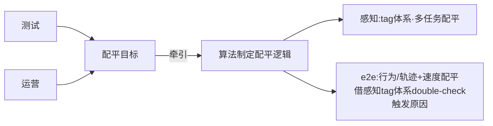

回传链路为独立专项，此处不展开：采集/测试数据经 pop 点，接管运营数据经 5G。

### 2.5 预研方案：WM 代替采集

流程变化：

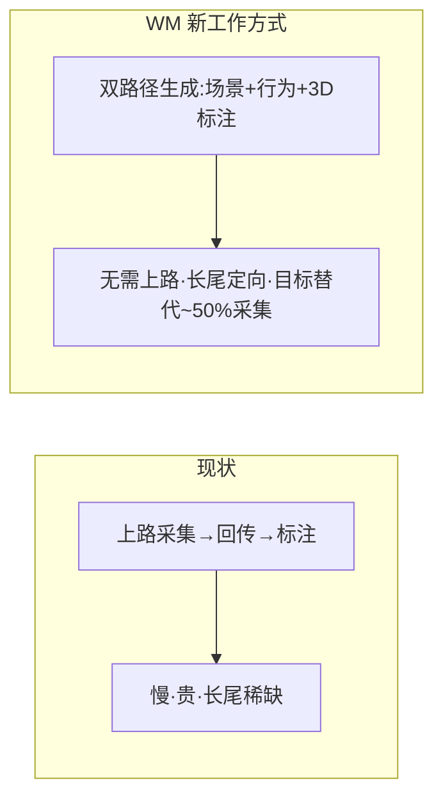

新方式的机制（WM 双路径）：

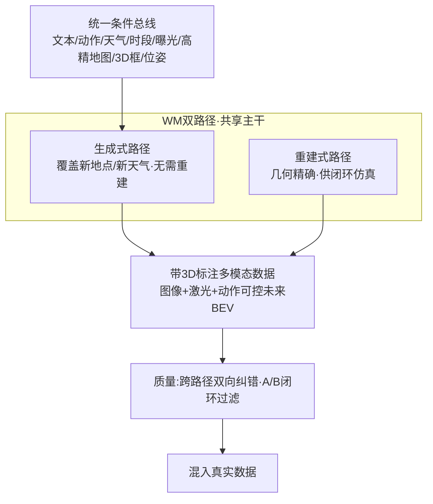

| | 优势 | 劣势 |
|---|---|---|
| 现状（真实采集） | 分布真实、可信 | 慢、贵、长尾稀缺、依赖上路 |
| WM 代替采集 | 免上路、长尾定向、自带标注、压 N 降本 | 保真/分布偏差、合规、预研未上线 |

---

## 3. 训练闭环

> 参考文档：[数据闭环](https://r3c0qt6yjw.feishu.cn/wiki/XS3twCuPAiutVbku6E4cERQ3n9e)
> 价值：产出对的模型｜TCO：算力·训练（时间）+ 训练任务数（数量）

### 3.1 训练范式阶梯

```mermaid
flowchart LR
  RB["rule based<br/>PNC不训练"] --> TS["two-stage e2e<br/>感知+学习PNC·分开/联合"] --> OS["one-stage e2e=VA<br/>不带perception"]
```

保留感知模块的方案（无论分开或联合训练）均属「感知+PNC」；不含感知模块的 one-stage VA 才是本文所指 e2e。

### 3.2 组织一：感知 + PNC

```mermaid
flowchart LR
  subgraph DATA1["数据侧"]
    SC["场景采集·专项为主"] --> TAG["tag体系·多任务配平"]
    LBL["预刷=离线模型预标·自动4D真值"] --> TAG
  end
  TAG --> PERC
  subgraph PERC["感知·多任务并行"]
    OD["OD"]
    LANE["Lane"]
    OCC["OCC"]
    TLD["TLD"]
    BAR["barrier"]
  end
  PERC --> PNC
  subgraph PNC["PNC·rule based或学习·two-stage"]
    PRED["预测"] --> PLAN["规划"] --> CTRL["控制"]
  end
  PERC -. 验证 .-> MILV["MIL开环单任务"]
  PNC -. 验证 .-> SILV["SIL闭环"]
```

1. 真值：预刷即离线模型预标注；配合自动 4D 真值。
2. 刷黑刷白：静态数据的挖掘与配平，此处不展开。
3. 加速：多任务与单任务联合优化，辅以 single task ft。

### 3.3 组织二：one-stage e2e（VA，预研）

```mermaid
flowchart LR
  DATA2["遥操采集数据"] --> PRE["pretrain+蒸馏"] --> FT["ft:感知辅助任务+traj预测"] --> POST["post-train RL"]
  POST -. 验证 .-> SIL2["SIL闭环"]
```

加速链路复杂：pretrain 加速、infra 调度、task 配平、ft 多任务配平、闭环仿真 rollout 加速、post 阶段并行（多 traj/action）。

### 3.4 对比

| 维度 | 感知+PNC | one-stage e2e |
|---|---|---|
| 结构 | 感知多任务+PNC 级联（perception 常驻） | 单模型三段式·无 perception |
| 数据/clip | 场景·tag 配平·短 clip | 遥操行为·轨迹+速度·长 clip |
| 加速 | 多/单任务优化·single task ft | pretrain/infra/task/ft多任务/闭环rollout/post并行 |
| 验证 | 感知MIL开环+PNC SIL闭环 | SIL闭环为主 |

### 3.5 预研方案：WM 嵌入训练

流程变化：

```mermaid
flowchart LR
  subgraph NOW["现状"]
    A1["离线数据集训练"] --> A2["受采集分布限制·无闭环反馈"]
  end
  subgraph WMX["WM 新工作方式"]
    B1["生成数据扩充+共享主干<br/>+闭环RL环境"] --> B2["分布可控·闭环RL提升"]
  end
```

| | 优势 | 劣势 |
|---|---|---|
| 现状（离线数据训练） | 稳定、可控 | 受采集分布限制、无闭环反馈 |
| WM 嵌入训练 | 分布可控、支持闭环 RL、共享表征 | 纯 proposal、主干耦合风险、算力大 |

评估口径：能否直接提升下游模型指标。
